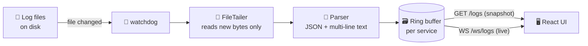

<div align="center">

# 📜 Live Log Viewer

### `tail -f` in your browser — for every service at once.

Point it at a folder of log files. It finds every service, lets you pick any mix of them,<br/>
and streams new lines live as they're written.

<br/>


**[Quick Start](#-quick-start)** · **[Features](#-features)** · **[How It Works](#-how-it-works)** · **[Configuration](#%EF%B8%8F-configuration)** · **[API](#-api)** · **[Troubleshooting](#-troubleshooting)**

</div>

---

## 🤔 Why?

Debugging across several services usually means a handful of SSH sessions, a wall of terminals
running `tail -f`, and a lot of `grep`. **Live Log Viewer replaces all of that with one browser tab.**

No database. No agents to install. No indexing pipeline. It reads the log files you already have
and keeps a small window of recent history in memory. It's up and running in about two minutes.

---

## ✨ Features

<table>
<tr>
<td width="50%" valign="top">

### 🔍 Zero-config discovery
Walks your log folder and turns it into **Groups → Services** automatically. Handles deep trees
and dated subfolders like `Service/Logs/2026-10-11/app.log`.

### ⚡ Truly live
`watchdog` spots changes and **only the newly appended bytes** are read. New entries reach the
browser over a WebSocket in under a second.

### 🧵 Stack traces stay whole
Multi-line records are grouped, so an exception and its 40 stack-frame lines show up as
**one row**, not 41.

</td>
<td width="50%" valign="top">

### 🧩 Any format
Auto-detects **JSON-lines** and common plain-text timestamp styles (ISO, Tomcat, access-log),
with timezone support.

### 🎛️ Powerful filters
Filter by service, **log level**, free-text search and time range, sorted newest or oldest
first. Click any row for full details.

### 🪶 Lightweight and safe on huge files
Never reads a whole file. Starts from the last 256 KB of each one, handles **log rotation**,
and keeps a fixed-size buffer per service.

</td>
</tr>
</table>

---

## 🚀 Quick Start

> **You'll need:** Python **3.10+** and Node.js **18+**

You run **two programs side by side**, each in its own terminal:

| | Program | Address |
|:-:|---|---|
| 🐍 | **Backend** (FastAPI) | `http://127.0.0.1:8000` |
| ⚛️ | **Frontend** (React) | **`http://localhost:5173`** ← open this |

### 0️⃣ Get the code

```bash
git clone https://github.com/theonlyoneH/Tailspin.git
cd Tailspin/live-log-viewer
```

> [!NOTE]
> The app lives in the [`live-log-viewer/`](live-log-viewer/) folder. Every path and command below is relative to it.

### 1️⃣ Tell it where your logs live

```bash
cd backend
cp .env.example .env          # Windows: copy .env.example .env
```

Then set `LOGVIEWER_ROOT` in `.env` to the folder that **directly contains** your group folders:

```ini
LOGVIEWER_ROOT=/var/log/myapps
```

> [!TIP]
> If a log lives at `C:/logs/platform/Api/api.log`, the root is **`C:/logs`**, not `C:/logs/platform`.

### 2️⃣ Start the backend

```bash
cd backend
./run.sh                      # Windows: run.bat   ·   PowerShell: .\run.bat
```

The first run creates a virtualenv and installs everything. Then check it found your logs:

```bash
curl http://127.0.0.1:8000/health      # "tracked_files" should be > 0
```

### 3️⃣ Start the frontend

In a **new terminal**:

```bash
cd frontend
./run.sh                      # Windows: run.bat   ·   PowerShell: .\run.bat
```

Open **http://localhost:5173**. 🎉

> [!NOTE]
> **To stop:** press `Ctrl+C` in both terminals. Nothing keeps running in the background.

### 🎭 No logs yet? Try the demo

```bash
python demo/demo_logs.py
```

This creates a realistic multi-service tree in `demo/logs/`, with Java-style and JSON logs and the
occasional stack trace, and keeps writing to it. Point `LOGVIEWER_ROOT` at that folder and watch the
lines roll in.

---

## 🧠 How It Works



| Stage | What happens |
|---|---|
| **🔍 Discover** | Each top-level folder is a **Group**. A folder becomes a **Service** if it directly holds a `.log`/`.txt` file or has a `log`/`logs` child folder. |
| **📖 Tail** | Each file has a `FileTailer` that remembers its byte offset and reads only what's new. Truncation and file replacement are detected automatically. |
| **🧩 Parse** | A line starting with a timestamp opens a new record, and lines without one are attached to it. The newest record is emitted after 1 s of quiet. |
| **📡 Deliver** | The UI loads an HTTP snapshot whenever filters change, then merges live WebSocket entries into one sorted, de-duplicated list. |

<details>
<summary><b>📂 Example folder layouts that just work</b></summary>

<br/>

```
/var/logs/                                   ← LOGVIEWER_ROOT
├── platform/                                ← Group
│   ├── Api/api.log                          ← Service "Api"
│   └── AdminPanel/Logs/2026-10-11/a.log     ← Service "Admin Panel"
└── bots/                                    ← Group
    └── eu/notifier_bot/n.log                ← Service "Eu / Notifier Bot"
```

</details>

<details>
<summary><b>🗂️ Project structure</b></summary>

<br/>

```
live-log-viewer/
├── backend/
│   ├── app/
│   │   ├── config.py        settings from env / .env
│   │   ├── discovery.py     folder tree → Groups & Services
│   │   ├── tailer.py        byte-offset tailing + rotation
│   │   ├── parser.py        text → structured records
│   │   ├── manager.py       poll loop, buffers, queries, fan-out
│   │   ├── models.py        LogEntry model
│   │   └── main.py          FastAPI routes + WebSocket
│   ├── tests/               pytest suite
│   └── run.sh / run.bat
├── frontend/
│   ├── src/
│   │   ├── App.jsx          state, snapshot + live merge
│   │   ├── api.js           fetch + WebSocket helpers
│   │   └── components/      Sidebar, FilterBar, LogTable, LogDetailDrawer
│   └── run.sh / run.bat
└── demo/demo_logs.py        live fake-log generator
```

</details>

---

## ⚙️ Configuration

Set these in `backend/.env` or as environment variables (environment variables take precedence).

| Variable | Default | Description |
|---|---|---|
| `LOGVIEWER_ROOT` | `./logs` | 📁 Folder containing your group folders. **The only required setting.** |
| `LOGVIEWER_MAX_BUFFER` | `5000` | 🗃️ Entries kept in memory **per service** |
| `LOGVIEWER_BACKFILL_BYTES` | `262144` | ⏪ Bytes read from the end of each file when first seen |
| `LOGVIEWER_MAX_DEPTH` | `6` | 🔽 How deep to search inside a group for services |
| `LOGVIEWER_FLUSH_IDLE_SECONDS` | `1.0` | ⏱️ Quiet time before a file's last record is emitted |
| `LOGVIEWER_CORS_ORIGINS` | `http://localhost:5173,…` | 🌐 Allowed browser origins |

> [!TIP]
> Memory use is roughly `services × MAX_BUFFER × ~1 KB`. On small machines such as a Raspberry Pi,
> set `LOGVIEWER_MAX_BUFFER=1000`.

---

## 📡 API

| Method | Endpoint | Description |
|:-:|---|---|
| `GET` | `/groups` | All groups and their services as `{ key, name }` |
| `GET` | `/logs` | Filtered snapshot of buffered entries |
| `GET` | `/health` | Status, tracked file count and buffer size |
| `WS` | `/ws/logs` | Live stream of new entries matching your filters |

<details>
<summary><b>🔎 <code>/logs</code> query parameters</b></summary>

<br/>

| Param | Example | Notes |
|---|---|---|
| `services` | `platform/Api` | Repeatable. Use the **keys** from `/groups`. |
| `levels` | `ERROR` | Repeatable |
| `search` | `timeout` | Case-insensitive substring |
| `time_range` | `5m` `30m` `1h` `6h` `today` | |
| `order` | `desc` | `asc` or `desc` |
| `limit` | `1000` | Max `5000` |

```bash
curl 'http://127.0.0.1:8000/logs?services=platform/Api&levels=ERROR&time_range=1h'
```

</details>

<details>
<summary><b>📨 WebSocket messages</b></summary>

<br/>

**Server → client**
```json
{ "type": "logs", "entries": [ { "id": 4211, "level": "ERROR", "service_key": "platform/Api", "message": "…" } ] }
```

**Client → server** (change filters without reconnecting)
```json
{ "type": "update_filters", "services": ["platform/Api"], "levels": ["ERROR"], "search": "timeout" }
```

</details>

---

## 🛠️ Development

<details>
<summary><b>Manual setup (what the run scripts do)</b></summary>

<br/>

```bash
# Backend
cd backend
python3 -m venv .venv
.venv/bin/pip install -r requirements.txt            # Windows: .venv\Scripts\pip
.venv/bin/uvicorn app.main:app --reload --port 8000

# Frontend
cd frontend
npm install
npm run dev
```

</details>

<details>
<summary><b>🧪 Running tests</b></summary>

<br/>

```bash
cd backend
python -m venv .venv_test
.venv_test/bin/pip install -r requirements-dev.txt     # Windows: .venv_test\Scripts\pip
.venv_test/bin/python -m pytest -q                     # Windows: .venv_test\Scripts\python
```

The tests cover multi-line parsing, JSON and epoch timestamps, timezones, byte-offset tailing,
UTF-8 split across writes, truncation, per-service buffers, and rescans.

</details>

<details>
<summary><b>📦 Production build</b></summary>

<br/>

```bash
cd frontend && npm run build      # → frontend/dist
```

Serve `frontend/dist` with nginx or Caddy and forward `/groups`, `/logs`, `/health` and `/ws/logs`
(with WebSocket upgrade) to the backend. Run the backend as a **single worker** without `--reload`:

```bash
.venv/bin/uvicorn app.main:app --host 127.0.0.1 --port 8000
```

</details>

---

## ⚠️ Limitations

> [!WARNING]
> **There's no authentication.** Anyone who can reach port `8000` can read every log. Keep it on
> `localhost`, or put it behind a reverse proxy that adds auth.

- 🖥️ **Single host, single process.** Logs from other machines need a shared mount.
- ⏳ **Short, temporary history.** The buffers are cleared on restart.
- 🔤 **Plain substring search.** No regex or field queries yet.
- 🕐 **Timestamps without a timezone** are read as server-local time.

---

## 🩺 Troubleshooting

| 😟 Symptom | ✅ Fix |
|---|---|
| Sidebar says *"No log sources discovered yet"* | Open `/health`. If `tracked_files` is `0`, `LOGVIEWER_ROOT` is wrong. It must **contain** the group folders. |
| `!! No backend/.env found` | Copy `.env.example` to `.env` and set `LOGVIEWER_ROOT`. |
| 🔴 Live dot is red / *disconnected* | The backend isn't running on port `8000`. |
| `address already in use` | An old backend or frontend is still running. Stop it. |
| `./run.sh: Permission denied` | `chmod +x run.sh` |
| PowerShell: `run.bat` not recognized | Type `.\run.bat` |
| A stack trace is split into two rows | Raise `LOGVIEWER_FLUSH_IDLE_SECONDS`. |
| High memory use | Lower `LOGVIEWER_MAX_BUFFER`. |

---

<div align="center">

**Made for developers who are tired of juggling terminals.** 🧑‍💻

If this saved you some `tail -f` pain, consider giving it a ⭐

</div>
